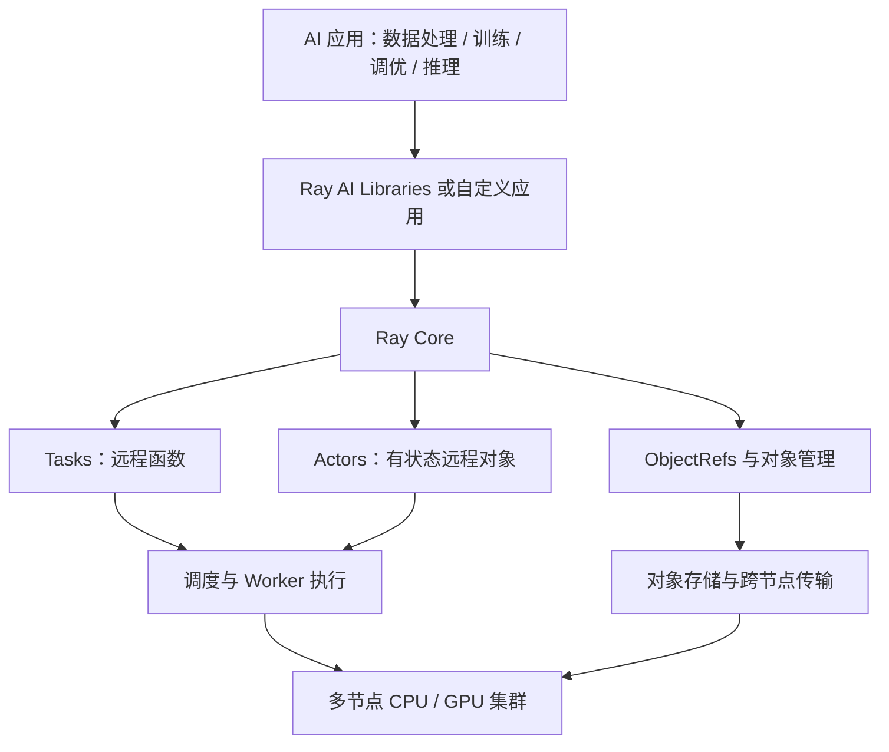
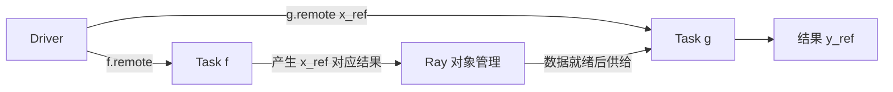
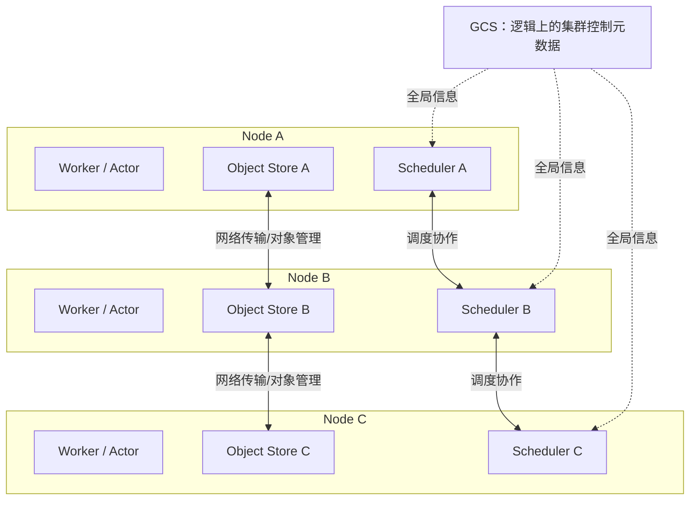
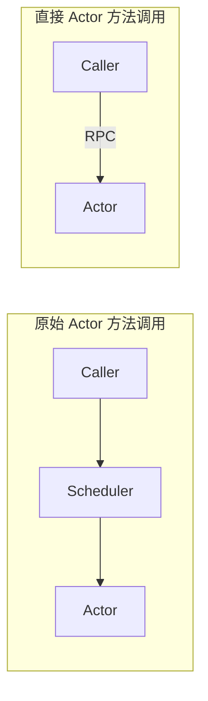

# Ray 分布式计算：我的 Berkeley CS267 学习笔记

> **课程来源**：Ion Stoica, *Ray: A Universal Framework for Distributed Computing*, 2025-03-04，共 83 页。  
> **学习方式**：按 PPT 顺序理解设计动机 → 基本抽象 → 架构与性能 → 容错与调度，并使用本地 Ray 实验验证部分机制。  
> **阅读说明**：以下是我以学生视角整理的理解，不是课件逐字转录；我把**PPT 原意**、**帮助理解的示例**和**本地实验的观察**尽量区分开。尤其 P55–81 中的“原始设计”和研究论文中的机制，不能直接等同于现行 Ray 版本的所有实现细节。

## 目录

- [01. 一张图看完整份 PPT](#01-一张图看完整份-ppt)
- [02. P1–4：Ray 的起源与讲述路线](#02-p14ray-的起源与讲述路线)
- [03. P5–11：为什么需要 Ray](#03-p511为什么需要-ray)
- [04. P12–17：Minimalist API 与 FAST](#04-p1217minimalist-api-与-fast)
- [05. P18–28：从函数到异步 Task](#05-p1828从函数到异步-task)
- [06. P29–36：Actor 与分布式 Object Store](#06-p2936actor-与分布式-object-store)
- [07. P37–40：Ray Core 与 AI 生态](#07-p3740ray-core-与-ai-生态)
- [08. P41–51：为什么需要 Compiled Graphs](#08-p4151为什么需要-compiled-graphs)
- [09. P52–54：异构推理与应用场景](#09-p5254异构推理与应用场景)
- [10. P55–61：最初的 Ray 系统架构](#10-p5561最初的-ray-系统架构)
- [11. P62–67：为什么引入 Actor 与可传递句柄](#11-p6267为什么引入-actor-与可传递句柄)
- [12. P68–73：Lineage、Ownership、容错](#12-p6873lineageownership容错)
- [13. P74–77：调度与 Direct Actor Calls](#13-p7477调度与-direct-actor-calls)
- [14. P78–81：灵活调度与 Ephemeral Resources](#14-p7881灵活调度与-ephemeral-resources)
- [15. P82–83：教授的最终经验教训](#15-p8283教授的最终经验教训)
- [16. 我在 Mac 上完成的实验与观察](#16-我在-mac-上完成的实验与观察)
- [17. 我最容易混淆的概念](#17-我最容易混淆的概念)
- [18. 知识框架与下一步源码阅读](#18-知识框架与下一步源码阅读)

---

## 01. 一张图看完整份 PPT

我现在认为，Ray 不只是一个“能让 Python 并行”的工具。它要提供**统一的分布式计算运行框架**：让开发者描述计算、状态、依赖和资源要求，让系统负责安排不同节点上的执行与数据管理。



我把课程主线理解为四个递进问题：

1. **为什么需要它？**（P5–11）AI 工作负载复杂，资源异构，多套系统难以协同。
2. **用什么抽象表达它？**（P12–36）Task、Actor、Future、对象存储。
3. **内部怎样支持它？**（P55–61）Worker、调度器、GCS、对象管理与容错。
4. **规模和性能要求提高后怎样演进？**（P41–54，P62–81）Compiled Graphs、Ownership、直接 Actor 调用、灵活调度。

---

## 02. P1–4：Ray 的起源与讲述路线

**P1**：标题为 *Ray: A universal framework for distributed computing*，授课者 Ion Stoica，日期为 2025 年 3 月 4 日。

**P2**：课件说 Ray 于 2016 年作为课程项目起步，最初瞄准分布式深度神经网络训练和强化学习的扩展问题。

**P3**：课件中的历史节点：2017 年 RLlib 和 Ray Tune 发布，2019 年 Anyscale 成立，2020 年 Ray 1.0，2022 年 Ray 2.0，之后 Ray Serve、KubeRay、Ray Data 逐渐发展。这是 PPT 的历史时间线，不是当前产品状态清单。

**P4**：目录页。我注意到教授先讲趋势与设计动机，后讲 Ray 编程模型，最后才进入原始架构、演进和经验教训。学系统框架时，先问“为什么”，再问“怎么实现”，确实更容易理解。

## 03. P5–11：为什么需要 Ray

**P5**：教授对比 Spark 代表的传统大数据和经典机器学习时代，与 Ray 希望服务的深度学习、强化学习和异构集群时代。这不是说 Spark 无法处理机器学习，而是强调当时主要的设计驱动力不同。

**P6**：我记住了 Ray 兴起时的三个趋势：

- AI 计算需求增长快于单机能力增长；
- 集群从相对同构的 CPU 节点走向 CPU/GPU 异构节点；
- AI 工作负载逐渐从单一任务变成复杂工作流。

**P7**：训练计算需求与硬件能力增长的对比图，强调“单机性能增长追不上代表性模型的计算需求增长”这一历史趋势。图中的倍增速率属于所引用研究的历史描述，不能当作对未来的确定预测。

**P8–9**：教授以推荐系统为例，展示预处理、训练/预训练、调优/微调、Serving，以及新增的 Batch Prediction。不同阶段对计算资源、吞吐、延迟的要求不同。

**P10**：如果每个阶段都要拼接不同的分布式系统，会带来开发、部署、管理难度和额外开销。

**P11**：Ray 希望提供一套统一计算底座，供多种上层工作负载使用。

**我的理解**：Ray 的价值不等于“自动让一个函数计算更快”。它解决的是**怎样组织跨节点、跨资源类型的复杂计算**。如果工作负载很小，单机 Python 反而可能更合适。

## 04. P12–17：Minimalist API 与 FAST

**P12**：从趋势转入 Ray 编程模型。

**P13：Minimalist API**。我用下面的表记忆：

| API              | 我怎么理解                                        |
| ---------------- | ------------------------------------------------- |
| `ray.init()`     | 初始化或连接 Ray 运行时                           |
| `@ray.remote`    | 声明可远程执行的函数或类                          |
| `.remote()`      | 提交远程操作；不需要等计算完成才能取得引用/句柄   |
| `ray.put(obj)`   | 将对象提交给 Ray 对象管理机制，并取得 `ObjectRef` |
| `ray.get(ref)`   | 获取实际结果；必要时阻塞等待                      |
| `ray.wait(refs)` | 取得一批引用中已就绪和未就绪的部分                |

课件把 `ray.put` 和 `ray.get` 标为同步操作；`.remote()` 的核心特点是远程操作异步提交。这里的非阻塞，是**相对计算完成而言**，不是说提交动作没有任何成本。

**P14–17：FAST Compute Model**：

- **F — Futures**：引用一个可能尚未产生的对象。
- **A — Actors**：远程类实例，能够保留状态。
- **S — Shared in-memory distributed object store**：分布式对象共享与管理。
- **T — Tasks**：远程函数计算。

我的记忆方法：**Task 做计算，Actor 保留状态，Future 表达结果和依赖，Object Store 帮助管理数据。**

## 05. P18–28：从函数到异步 Task

**P18–20**：普通 Python 同步调用会按顺序等待：先 `f(a)` 结束，再运行 `f(b)`。

**P21–22**：加入 `@ray.remote`，用 `.remote()` 提交任务，Driver 和 Worker 的角色开始分离。

**P23–28**：动画依次展示：

1. Driver 提交第一个 Task；
2. `x_ref` 先返回，即使结果还没计算完；
3. Driver 可以继续提交第二个 Task，得到 `y_ref`；
4. `ray.get([x_ref, y_ref])` 在需要结果时等待；
5. 两个 Worker 可以在资源足够时并发执行；
6. Driver 最终取到实际值。

```python
import time
import ray

ray.init()

@ray.remote(num_cpus=1)
def square(x):
    time.sleep(2)
    return x * x

x_ref = square.remote(3)
y_ref = square.remote(4)

# 此处 x_ref / y_ref 是引用，不是 9 / 16
print(ray.get([x_ref, y_ref]))  # [9, 16]
```

**我容易误会的地方**：

- 两个 Task 不等于两个必须不同的操作系统进程。Ray Worker 可以复用。
- `ray.get(y_ref)` 阻塞 Driver 的调用，不会因此暂停已经提交的 `x_ref` Task。
- 有两个 `.remote()` 不保证一定并行；还要满足 CPU/GPU 等资源条件。

## 06. P29–36：Actor 与分布式 Object Store

### P29–31：从普通类到远程 Actor

普通类的 `Counter()` 在当前 Python 进程创建实例；Ray 的 `Counter.remote()` 创建远程 Actor，Driver 得到 `ActorHandle`。

```python
@ray.remote(num_cpus=1)
class Counter:
    def __init__(self):
        self.value = 0

    def inc(self):
        self.value += 1
        return self.value

c = Counter.remote()       # ActorHandle
ref = c.inc.remote()       # ObjectRef
value = ray.get(ref)       # int: 1
```

**P31** 补充 `num_cpus`、`num_gpus` 这样的资源声明。它首先表达调度资源需求，不等于自己实现了 GPU 通信协议。

### P32–36：为什么任务间不用 Driver 中转所有数据？

课件构造：

```python
x_ref = f.remote()
y_ref = g.remote(x_ref)
```

我一开始不理解：没有 `ray.get(x_ref)`，`g` 怎么拿到 `f` 的结果？

现在我理解：当 `ObjectRef` 作为**顶层参数**传给远程函数时，Ray 会跟踪任务依赖，等待上游数据可用，为下游 Worker 准备实际参数，再执行下游函数体。



**P32–35**：在跨节点情形中，Ray 可以避免把数据从生产者先传回 Driver，再由 Driver 发给消费者；**P36** 给出“没有对象存储时中转两次”的对比。

我也明确了：这里的“共享”不是多台机器拥有同一块物理 RAM，而是**每台机器有本地对象管理能力，集群通过网络让数据可被其他节点使用**。实际小对象、大对象的传输实现可能不同，不能把 PPT 示意图理解为所有对象的固定路径。

## 07. P37–40：Ray Core 与 AI 生态

**P37**：Ray Ecosystem 是分层架构：底层计算基础设施、中间 Ray Core、上层 Ray Data / Train / Tune / Serve / RLlib，以及使用 Ray Core 构建的自定义应用。

**P38–39**：教授用企业案例和基础模型训练案例说明 Ray 的应用范围。它们是 PPT 展示的历史案例，不必由此推断相关公司的全部现有部署情况。

**P40**：历史背景扩展到 LLM、更多加速器和纵向集成的硬件系统（例如 TPU Pods）。

**我的理解**：PyTorch、JAX 等负责具体张量计算；Ray 可以承担分布式应用的执行编排。Ray Core 不等于 PyTorch，也不等于 Ray Train 这一高级库。

## 08. P41–51：为什么需要 Compiled Graphs

这一部分我第一次没有听懂，后来用“工厂固定流水线”理解了：**如果每次都是 `A → B`，为什么每执行一次还要承担重复安排和通信的成本？**

### P41–44：经典 Ray API 的细粒度开销

**P41**：Ray 经典 API 动态、灵活，但小任务会受到 RPC、动态内存分配和高性能点对点通信安排等成本影响。

**P42**：RPC-like 执行示例有四次数据复制。

**P43–44**：Ray Core 的共享内存对象存储减少了示例中的数据复制，P44 用**两次数据复制、六次 RPC**说明其取舍；这是幻灯片中的示意计数，非所有程序的固定开销。

### P45–49：静态图解决重复安排问题

**P45** 提出 Compiled Graphs：静态任务图、类似 Ray Core 的 API、资源预分配与复用、通信安排预先确定。课件列出的目标包括 1–10 毫秒任务的系统开销低于 1%，以及 GPU-GPU 数据传输每次操作系统开销低于 10 微秒。**这是设计目标，不是该页的通用实测保证。**

**P46**：理想执行路径希望减少每次调用时的控制 RPC 和动态内存分配。

**P47–48**：定义并编译 DAG（Directed Acyclic Graph，有向无环图），准备重复使用的执行结构和缓冲区。

**P49**：执行编译后的图，得到 `CompiledDAGRef` 一类结果引用。课件中部分示例方法名/输出不完全一致，所以我把它们理解为**解释机制的示意代码**。

```python
# PPT 示意：表达结构，不保证可直接复制运行
with ray.dag.InputNode() as inp:
    middle = a.inc.bind(inp)
    dag = b.inc.bind(middle)

compiled = dag.experimental_compile()
ref = compiled.execute(1)
```

这里所谓“编译”，主要是准备**任务间的运行关系、资源与通信安排**，不是把所有 Python 函数体都编译为本地机器码。

### P50–51：GPU 通信路径

**P50**：课件展示传统 GPU Tensor 传输可能通过主机内存与对象存储中转。

**P51**：给 Compiled Graph 中的张量传递指定 `TorchTensorType(transport="nccl")`，使通信安排在编译阶段确定，并展示 GPU 间通过 NCCL 传输数据的路径。图中的“直接”是避免所画的共享内存中转路径，并非物理硬件中完全没有其他组件参与。

**我的理解**：Compiled Graph 并不替代动态 Ray Core；它适合**计算结构重复、延迟和通信开销十分敏感**的场景。

## 09. P52–54：异构推理与应用场景

**P52**：在线推理可以将读取/写入安排到 CPU，将模型计算安排到 GPU。课件提出合理利用 CPU/GPU 异构性可显著降低成本，并展示“10x”主张；单凭该页无法确定普适收益。

**P53**：展示在线推理、微调、Embedding 计算、多模态搜索、多模型搜索等工作流。

**P54**：通过 verl、OpenRLHF、Tülu 3 等案例说明 Ray 在当时的测试时计算/后训练生态中的使用。

我理解：复杂 AI 应用是一组性质不同的计算阶段，而不只是运行单个模型。

## 10. P55–61：最初的 Ray 系统架构

**P55**：进入 *Original Design*。这是历史原始设计，必须和今天 Ray 的实现细节区分。

**P56**：每个节点上可以有 Driver、Worker/Actor 和本地 Object Store；对象存储的模型强调**不可变对象**。

**P57–58**：各节点具有 Scheduler，调度工作可在节点间协调。

**P59**：Global Control Store（GCS）提供集群范围的控制元数据。原始图示包括 Object Table、Task Table（计算图/Lineage）。

**P60**：强调去中心化 Scheduler、Sharded GCS，以及 Worker 也能够提交新的任务，避免 Driver 成为所有新任务的瓶颈。

**P61**：Lineage-based fault tolerance：通过记录任务关系，在条件允许时重放计算、重建丢失对象。

### 我最关心的问题：谁是全局的，谁是每台机器自己的？

| 组件           | 从 PPT 原始架构理解其范围            | 物理上是什么                                           |
| -------------- | ------------------------------------ | ------------------------------------------------------ |
| Worker / Actor | 单个运行实例                         | 某个节点上的进程                                       |
| Object Store   | 节点本地实例 + 集群级对象共享机制    | 分布在不同节点上的存储                                 |
| Scheduler      | 原始设计中每节点有调度器，节点间协作 | 分布式控制组件                                         |
| GCS            | **逻辑上的全局控制信息服务**         | 原始设计可通过分片扩展，不能理解为所有数据都在一个仓库 |
| Driver         | 发起和组织计算的程序                 | 运行在某个节点或客户端                                 |



**我终于理解“分布式”的含义**：不是三台电脑共享一块 RAM，而是每台电脑各自执行、存储和管理一部分工作，通过网络和统一编程模型协作。**逻辑全局**与**物理分散**可以同时成立。

## 11. P62–67：为什么引入 Actor 与可传递句柄

**P62**：进入 *Evolution & Lessons Learned*。

**P63**：教授总结，开发者对功能与性能的关注可能超过框架设计者想象中的调试与容错优雅性。

**P64**：Ray 最初从 Task-only 抽象起步。确定性、无状态 Task 的重放容错相对容易。

**P65**：为什么增加 Actor？课件提出两个主要原因：

- **性能**：GPU 数据移动与深度学习环境初始化成本高，值得复用长期运行的进程/状态。
- **功能**：强化学习环境（例如闭源游戏）的内部状态不一定能抽取成普通对象在 Task 间传递。

**P66–67**：早期设计限制了谁可以调用 Actor；后来为实现 Parameter Server 等模式，允许把 `ActorHandle` 传给其他 Worker/Actor，让它们访问同一个远程有状态对象。

我记住：**ActorHandle 不是 Actor 的状态副本，而是调用该远程 Actor 的句柄**。这和引用一次结果的 `ObjectRef` 完全不同。

## 12. P68–73：Lineage、Ownership、容错

### P68–69：Lineage Stash

**P68**：最初设计在远程函数执行之前，先向 GCS 写入参数相关的 Lineage，确保失败时有重放所需的信息，但这会增加调用延迟。

**P69**：Lineage Stash 的思路是随函数调用携带相关 Lineage，并周期性写入 GCS，限制每次携带的规模，从而减少关键路径上的持久化等待。这是 PPT 介绍的演进研究思路。

### P70–72：Ownership

**P70**：原始设计中，由 GCS 集中（可分片）维护对象重建相关元数据会影响延迟和吞吐量。系统还必须解决“由谁发现丢失、由谁重建、怎样避免重复重建”问题。

**P71**：Ownership 设计：**提交 `x = f.remote()` 的 Worker 是 x 对应 Future 的 Owner，负责其元数据和重建协调。**

**P72**：PPT 提出不变量：Owner 不存活时，对象在系统语义上不能继续被正常引用（fate sharing）。这不等于对象的字节必定立即从所有机器的内存消失。

我用下表区分三种角色：

| 对象相关角色       | 职责                     |
| ------------------ | ------------------------ |
| Owner              | 管理对象元数据、协调重建 |
| 执行计算的 Worker  | 产生计算结果             |
| 实际存储对象的节点 | 持有对象数据             |

**Owner 不一定等于计算者，也不一定等于数据所在位置。**

### P73：Actor 故障恢复

教授讲述了 Ray 曾尝试为 Actor 提供透明 Checkpoint + 重放，但遇到多线程非确定性、无状态 Actor 的额外保存开销，以及 Gang Scheduling 下故障后资源不足等问题。课件最终强调：框架保障可配置的自动重启能力，业务 Checkpoint 和恢复逻辑由应用负责。

这里我尤其记住：**进程重新启动，不代表 Actor 里的模型参数、计数器或优化器状态自动恢复到崩溃前。**

## 13. P74–77：调度与 Direct Actor Calls

**P74**：原始 Actor 创建调度在节点资源不足时可能递归向其他节点 Spill Over。

**P75**：原始设计的 Actor 方法调用也需要经过 Scheduler。教授直接指出：所有调用经 Scheduler 会慢。

**P76**：改进创建 Actor 时的调度方式，引入图中所说的 Iterative Scheduling。

**P77**：改进为 **Direct Actor Calls**。Actor 位置已确定后，常规方法调用可以直接发送 RPC，而不必每次绕经 Scheduler。



我明白了：**Actor 的初始放置仍然需要资源调度，但已经创建的 Actor 处理方法请求时，不应该无意义地重复经过完整调度路径。**

## 14. P78–81：灵活调度与 Ephemeral Resources

**P78**：不同应用需要不同策略：Affinity、Anti-affinity、Gang Scheduling、Data Locality 等。问题是怎样用可扩展的方式表达这些策略。

**P79**：课件引用 ESCHER（SoCC 2022），介绍利用动态创建的**逻辑资源**表达调度约束的研究思路：资源约束调度 + Ephemeral Resources → 能表达丰富调度策略。

**P80**：在 Node 2 上产生对象 `x`，创建一个容量为 1 的逻辑资源 `x_r`。

**P81**：从 Node 1 提交需要逻辑资源 `x_r` 的计算：

```python
# 来自 PPT，用于说明资源约束思想
f.options(resources={"x_r": 1}).remote(x)
```

由于 `x_r` 位于 Node 2，调度结果能够让 `f(x)` 靠近对象 `x` 的位置，实现一个数据局部性示例。

**重要边界**：`x_r` 不是额外创建出来的 CPU、GPU 或内存硬件，而是调度约束的逻辑名称；这几页展示的研究机制不能直接等同于 Ray 2.47.1 中所有动态资源 API 的现成功能。

## 15. P82–83：教授的最终经验教训

**P82** 的三点总结：

1. Ray 核心 API 在 PPT 所讨论的数年内保持了相当稳定，教授认为这与它的简洁性和表达能力有关。
2. **简单 API 让分布式计算变得更容易，但不会让它变成一件简单的事。** 很多用户使用更高层的 Ray Libraries 来隐藏并行细节。
3. 异构性越来越重要，包括 Batch Inference、Disaggregated Prefill、Disaggregated Encoding 等场景。

**P83** 的最终结论：分布式 AI 应用越来越普遍，构建它们依然很困难，Ray 希望通过统一框架显著简化分布式计算。

**我的课程总感想**：Ray 不是魔法。它把远程执行、任务依赖、状态、资源调度、对象管理、容错的一部分通用复杂性封装了起来，但业务仍需自己考虑性能、数据布局、故障语义以及模型状态恢复。

---

## 16. 我在 Mac 上完成的实验与观察

> 以下是我本地真实运行的输出摘要，属于学习实验记录，不是 PPT 自带的基准测试。

### 环境

- 电脑：MacBook Pro；Shell：zsh。
- 虚拟环境：项目目录下 `.venv`。
- 安装并确认：`ray.__version__ == '2.47.1'`。
- Ray 本地启动时报告 `CPU: 16.0`。

### 实验 01：两个独立 Task

我执行：

```bash
python examples/01_task_future.py
```

观察结果：

```text
x_ref 类型：ObjectRef
提交后时间：0.01s
结果：[{'x': 3, 'result': 9, 'worker_pid': 81807},
      {'x': 4, 'result': 16, 'worker_pid': 81811}]
总时间：2.04s
```

我学到：提交任务可以比任务执行快得多；两个不同 PID 表明这次实验由不同进程执行；资源允许时两个 2 秒任务可以并发，总耗时约 2 秒。

### 实验 05：ObjectRef 直接表达数据依赖

我执行：

```bash
python examples/05_dependency_self.py
```

核心代码：

```python
x_ref = produce.remote()
y_ref = consume.remote(x_ref)
print(ray.get(y_ref))
```

我的实际输出中：

```text
x_ref: ObjectRef
y_ref: ObjectRef
produce PID: 87115
consume PID: 87115
收到数据: [10, 20, 30]
最终结果: 60
```

第二次执行时 `produce` 和 `consume` 同样复用了一个 PID（87150）。

我学到的不是“两个 Task 必须在两个进程”：**Task 是计算调用；Worker 是执行进程，Worker 可以被复用。**

更重要的是，我没有在 Driver 上 `ray.get(x_ref)`，Ray 仍然能够处理 `consume` 对 `produce` 结果的依赖。对于这个小列表和单机实验，不能声称已验证真正的跨机器 Object Store 网络传输。

### 下一步才需要补做的实验

- 运行并观察 `02_actor.py`：ActorHandle、状态和 PID。
- 通过 `ray start --head` 观察 Dashboard 上的节点与 Actor。
- 用 CPU 资源约束实验验证调度排队。

我不把尚未展示实际输出的实验写成“已经验证”。

## 17. 我最容易混淆的概念

| 我以前可能误会                        | 现在的理解                                                   |
| ------------------------------------- | ------------------------------------------------------------ |
| `ObjectRef` 就是结果                  | 它是结果的引用；结果可以尚未产生                             |
| ActorHandle 和 ObjectRef 一样         | ActorHandle 指向可反复调用的远程对象；ObjectRef 指向一次计算结果 |
| 两个 Task 必须对应两个 PID            | 不一定；Worker 可以复用                                      |
| `ray.get` 才能让下游 Task 得到数据    | 顶层 `ObjectRef` 参数可建立自动解析的任务依赖                |
| Object Store 是全局共享的一块 RAM     | 各节点有独立存储；共享的是跨节点对象管理和访问能力           |
| GCS 保存所有真实计算数据              | PPT 原始架构中的 GCS 主要保存控制元数据，实际数据和对象管理是另一层 |
| Scheduler 只有一个总进程              | 原始设计强调每节点调度器和分布式协作                         |
| “全局”就不能“分布式”                  | 逻辑统一、物理分散可以同时成立                               |
| Ray 管理 GPU 就等于帮我同步梯度       | Ray 主要调度/管理计算；PyTorch DDP/NCCL 负责相应的梯度同步通信 |
| Actor 重启后状态自动全部恢复          | 进程重启与业务 Checkpoint/恢复是两件事                       |
| Compiled Graph 编译 Python 数学代码   | 课件侧重提前准备任务图、资源和通信路径                       |
| Direct Actor Calls 不再需要 Scheduler | 创建/放置 Actor 仍需要调度；方法调用可以走更短路径           |
| Ephemeral Resource 是新 CPU           | 它是用来表达调度约束的逻辑资源                               |

### 我用来复习的五个问题

1. 为什么 Ray 需要同时提供 Task 和 Actor？
2. 为什么 `g.remote(x_ref)` 通常不需要 Driver 先 `ray.get(x_ref)`？
3. Object Store、Scheduler、GCS 各自属于怎样的逻辑/物理层次？
4. Lineage 与 Ownership 分别解决对象重建中的什么问题？
5. 为什么一个固定结构反复执行的计算图适合考虑 Compiled Graph？

如果能清楚回答这五个问题，我就不只是记住 API 了，而是开始理解 Ray 的系统设计。

## 18. 知识框架与下一步源码阅读

这部分是**我的延伸学习路线**，不是 Berkeley PPT 原文。

我接下来准备读的项目是 [`owenliang/ray-train`](https://github.com/owenliang/ray-train)。虽然它叫 `ray-train`，但代码主要是用 **Ray Core 自己组织 PyTorch DDP**，而不是直接使用高级 Ray Train 的 `TorchTrainer`。

| 项目文件                                                     | 我希望用 PPT 哪些知识解释                                    |
| ------------------------------------------------------------ | ------------------------------------------------------------ |
| [`submit_train.py`](https://github.com/owenliang/ray-train/blob/main/submit_train.py) | Job 提交、Driver 入口、运行环境                              |
| [`train/train_entry.py`](https://github.com/owenliang/ray-train/blob/main/train/train_entry.py) | Ray 初始化、Placement Group、Actor 创建、ObjectRef、调用与日志回传 |
| [`train/ddp_worker.py`](https://github.com/owenliang/ray-train/blob/main/train/ddp_worker.py) | Actor 内部状态、GPU 资源、PyTorch DDP、NCCL、Checkpoint      |

我先建立三条分工边界：

```text
Ray Core             负责远程进程/Actor、计算编排和资源调度
PyTorch DDP          负责数据并行训练机制与梯度同步
NCCL                 提供 GPU 集合通信能力
```

**最终学习目标**：从任务提交开始，独立解释 Ray 怎样创建训练 Actor、安排 CPU/GPU 资源、处理远程调用与对象结果，再说明真正的梯度同步与状态恢复由哪一层负责。

---

## 附录：逐页定位索引

| 页码  | PPT 主线                      | 页码  | PPT 主线                       |
| ----- | ----------------------------- | ----- | ------------------------------ |
| 1–4   | 标题、起源、课程路线          | 5–11  | 历史趋势与统一计算底座         |
| 12–17 | Minimalist API、FAST          | 18–28 | 普通函数到异步 Task / Future   |
| 29–31 | Actor 类与资源声明            | 32–36 | Object Store、跨任务数据依赖   |
| 37–40 | Ray Ecosystem 与 LLM          | 41–44 | 经典执行的复制与 RPC 开销      |
| 45–49 | Compiled Graph 构建/执行      | 50–51 | GPU 数据移动与 NCCL            |
| 52–54 | CPU/GPU 异构应用              | 55–61 | 原始架构、GCS、调度与容错      |
| 62–67 | Actor 的设计动机及句柄传递    | 68–73 | Lineage、Ownership、Actor 容错 |
| 74–77 | 原始调度与 Direct Actor Calls | 78–81 | 灵活策略、Ephemeral Resources  |
| 82–83 | 经验教训与总结                |       |                                |

### 课件提到的相关论文（由 PPT 引用）

- *Lineage Stash: Fault Tolerance Off the Critical Path* — Stephanie Wang et al., SOSP 2019（P69）。
- *Ownership: A Distributed Futures System for Fine-Grained Tasks* — Stephanie Wang et al., OSDI 2021（P71–72）。
- *ESCHER: Expressive Scheduling With Ephemeral Resources* — Romil Bhardwaj et al., SoCC 2022（P79–81）。

> **最后一句给自己**：我学习 Ray 的目标，不只是写出 `@ray.remote`，而是理解“在不同机器上，谁执行、谁调度、谁管理数据、谁拥有对象、发生故障后由谁负责”。当我能把这些关系讲清楚，才算真正开始掌握 Ray。
